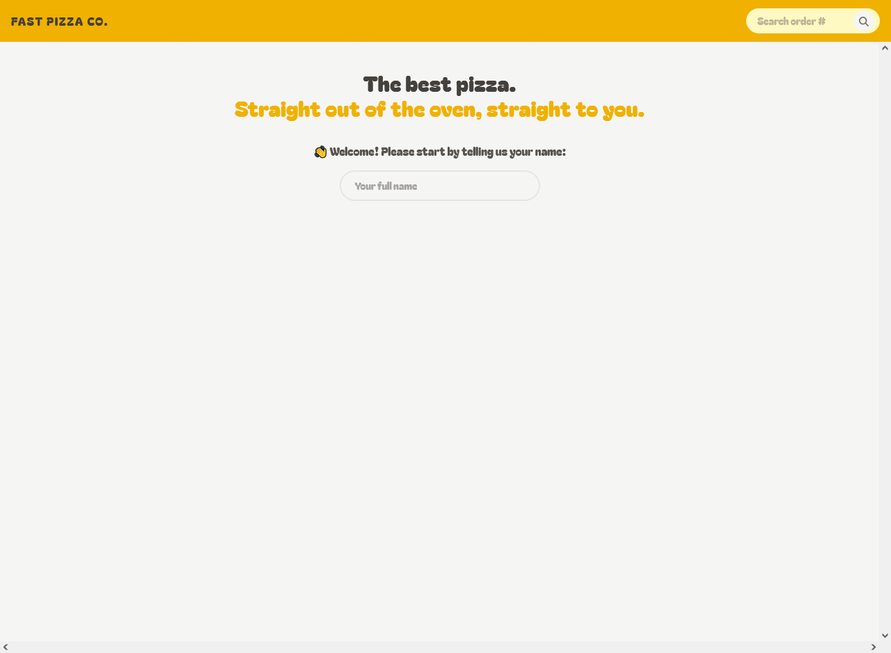

# Fast React Pizza Co.

A pizza ordering app. Browse the menu, build a cart, place an order with an address filled in from your location, and track it by order ID.

**[Live Demo](https://fast-pizza-co-app.vercel.app/)**



## Table of Contents

1. [Features](#features)
2. [Tech Stack](#tech-stack)
3. [How It Works](#how-it-works)
4. [Project Structure](#project-structure)
5. [Getting Started (How to Use)](#getting-started-how-to-use)
6. [Build](#build)
7. [Deployment](#deployment)
8. [Contributions (Adding Your Own Features)](#contributions-adding-your-own-features)
9. [License & Author](#license--author)

## Features

- Enter your name on the home page; the app greets you by name and pre-fills it in the order form. Your name and cart are saved in the browser's `localStorage`, so they survive a page refresh.
- Browse the menu with photos, ingredients, and prices. Sold-out pizzas are greyed out and cannot be added.
- Add, remove, and change quantities from the menu or from the cart page. Totals update instantly.
- A cart summary bar at the bottom of every page shows the pizza count and total, with a link to the cart.
- Place an order with name, phone number, and address. A "Get your location" button fills in the address using the browser's geolocation and a reverse-geocoding API; you can correct it by hand.
- Optional priority delivery for an extra 15%, with the total shown on the order button.
- Validation of name, phone number, and address, with the errors shown right inside the form. If anything is invalid, your cart is kept; it is cleared only after the order is placed successfully.
- All prices are shown in pounds (£).
- Track any order by ID from the search box in the header: delivery countdown, items with ingredients, and price breakdown.
- Upgrade an existing order to priority from its status page.
- Loading overlay during page transitions and a friendly error page with a "Go back" button when a request fails.
- Responsive layout for phones and desktops.

## Tech Stack

- React 18 and Vite 6
- React Router 6 (`createBrowserRouter`) with route loaders and actions for data fetching and form handling
- Redux Toolkit (`createSlice`, `createAsyncThunk`) and React Redux for the cart and user state
- Tailwind CSS 4 (via the `@tailwindcss/vite` plugin)
- Font Awesome icons
- ESLint and Prettier (with the Tailwind class-sorting plugin)
- Deployed on Vercel

## How It Works

**Routing.** `App.jsx` defines one layout route with five pages: `/` (home), `/menu`, `/cart`, `/order/new`, and `/order/:orderId`. The layout renders the header, the page (through `<Outlet />`), and the cart summary bar. It also reads `useNavigation()` to show a loading overlay while a loader is running.

**Data fetching with loaders.** The menu and order pages use React Router loaders, so the data is fetched before the page renders and read with `useLoaderData()`. If a loader throws (for example, an order ID that does not exist), the route's `errorElement` shows the `Error` page. The order page also uses `useFetcher` to load the menu in the background and look up each ordered pizza's ingredients.

**Form handling with actions.** The order form is a React Router `<Form method="POST">`. Its `action` reads the form data, validates the name, phone number, and address, sends the order to the API, clears the cart (only after the API accepts the order), and redirects to `/order/<id>`. Validation errors are returned from the action and read in the component with `useActionData()`. The "Make a priority" button on the order page works the same way with a `PATCH` action.

**State with Redux Toolkit.** There are two slices, combined in `store.js`:

- `cartSlice` holds the cart items and has the reducers `addItem`, `removeItem`, `increaseQuantity`, `decreaseQuantity`, and `clearCart`. Item totals are recalculated whenever a quantity changes.
- `userSlice` holds the username and the address data. `fetchAddress` is a `createAsyncThunk` that gets the browser's position, calls the reverse-geocoding API, and builds an address string. Its `pending`, `fulfilled`, and `rejected` cases set the loading and error status that the form reads.

Cart totals in the summary bar and the cart page are derived with `reduce` on each render instead of being stored.

**Persistence.** Redux state lives in memory, so `store.js` loads the cart items and the username from `localStorage` as the store's `preloadedState` and saves them again on every change with `store.subscribe`. The address and position are not saved. Storage errors are caught, so blocked or corrupted storage just starts a fresh state.

**Data sources.**

- Menu and orders: the public [React Fast Pizza API](https://react-fast-pizza-api.jonas.io/api) (`GET /menu`, `GET /order/:id`, `POST /order`, `PATCH /order/:id`).
- Address lookup: the [BigDataCloud](https://www.bigdatacloud.com/) reverse-geocoding client API.

## Project Structure

```
public/
src/
  App.jsx                  # router setup
  main.jsx                 # entry point, Redux Provider
  store.js                 # configureStore (user + cart) + localStorage persistence
  index.css                # Tailwind import, custom .input and .loader
  features/
    cart/
      Cart.jsx
      CartItem.jsx
      CartOverview.jsx     # summary bar shown on every page
      EmptyCart.jsx
      UpdateQuantity.jsx
      cartSlice.js
    menu/
      Menu.jsx             # page + loader
      MenuItem.jsx
    order/
      CreateOrder.jsx      # form + action
      Order.jsx            # status page + loader
      OrderItem.jsx
      SearchOrder.jsx
      UpdateOrder.jsx      # priority button + action
    user/
      CreateUser.jsx
      UserName.jsx
      userSlice.js         # includes the fetchAddress thunk
  services/
    apiGeocoding.js        # reverse geocoding
    apiRestaurant.js       # menu and order requests
  ui/
    Button.jsx
    Error.jsx
    Header.jsx
    Home.jsx
    Layout.jsx
    LinkButton.jsx
    Loader.jsx
  utils/
    helpers.js             # currency, date, and minutes-left formatting
```

## Getting Started (How to Use)

You need Node.js 18 or newer.

```bash
git clone https://github.com/Ahmed-Abdlhameed/Fast-Pizza-Co.git
cd Fast-Pizza-Co
npm install
npm run dev
```

The app runs at [http://localhost:5173](http://localhost:5173).

Place a test order from the menu, or search for an existing order ID in the header (for example `IIDSAT` or `CQE92U`, the test IDs noted in the source code).

Other scripts:

```bash
npm run lint      # ESLint
npm run preview   # serve the production build locally
```

## Build

```bash
npm run build
```

The output goes to `dist/`.

## Deployment

The app is deployed on Vercel, which redeploys automatically on every push to `main`.

Because the app uses client-side routing, the server only has one real page (`index.html`). A refresh on `/menu` or `/order/ABC123` would return a 404 without a rewrite, so `vercel.json` sends every path to `index.html` and lets React Router handle the URL:

```json
{
  "rewrites": [{ "source": "/(.*)", "destination": "/index.html" }]
}
```

## Contributions (Adding Your Own Features)

Feel free to fork the repository and contribute by adding features or fixes. Pull requests are welcomed!

## License & Author

This repository is for personal documentation purposes. Feel free to use or distribute its content as you wish. Built by **Ahmed Abdelhameed**. Find me on [GitHub](https://github.com/Ahmed-Abdlhameed).
